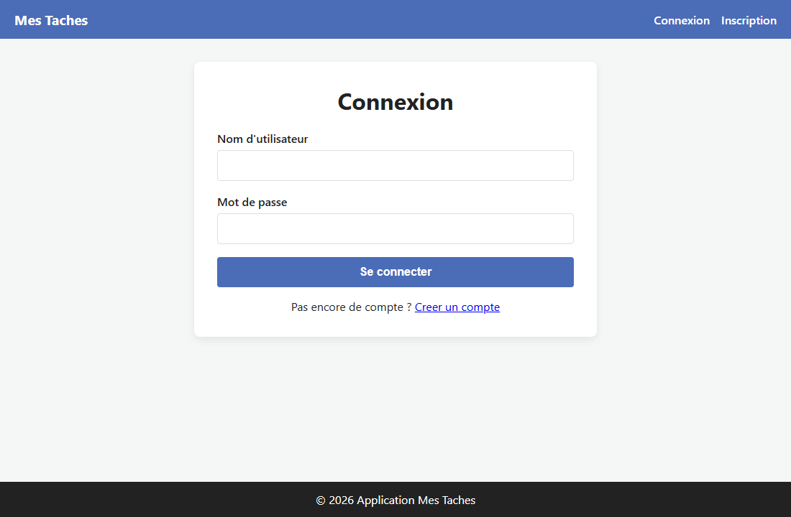
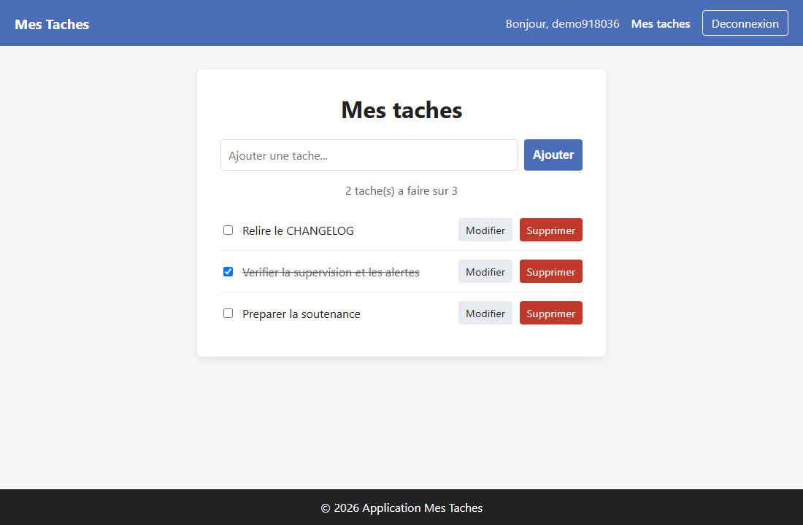
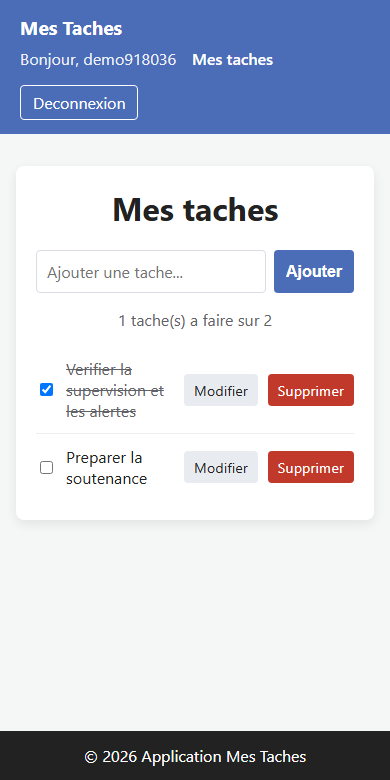
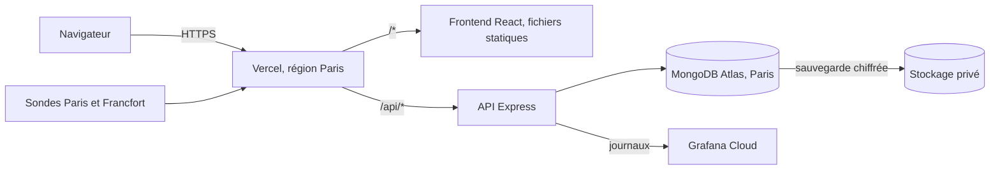
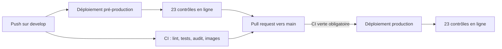
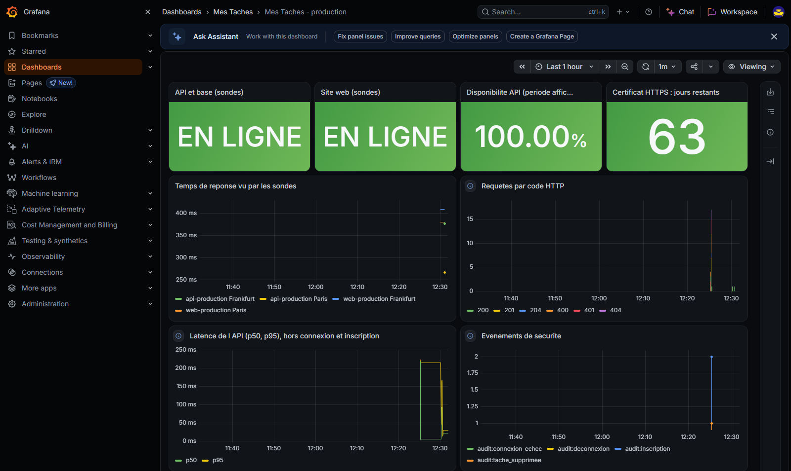

# Mes Tâches

Application de gestion de tâches, sécurisée, supervisée et déployée en continu.
Frontend React, API Node.js, base MongoDB.

[](https://github.com/MoadAbdel/exam-taskapp/actions/workflows/ci.yml)
[](https://github.com/MoadAbdel/exam-taskapp/actions/workflows/deploy.yml)


**[Ouvrir l'application](https://exam-taskapp.vercel.app)** · [Journal des évolutions](CHANGELOG.md) · [API (OpenAPI)](docs/openapi.yaml) · [Confidentialité](https://exam-taskapp.vercel.app/privacy)

| Connexion | Mes tâches | Mobile |
| :---: | :---: | :---: |
|  |  |  |

## Sommaire

- [Fonctionnalités](#fonctionnalités)
- [Architecture](#architecture)
- [Environnements](#environnements)
- [Démarrage rapide](#démarrage-rapide)
- [API](#api)
- [Qualité et tests](#qualité-et-tests)
- [CI/CD](#cicd)
- [Sécurité et vie privée](#sécurité-et-vie-privée)
- [Supervision, journaux et audit](#supervision-journaux-et-audit)
- [Sauvegarde et restauration](#sauvegarde-et-restauration)
- [Configuration](#configuration)

## Fonctionnalités

- Inscription, connexion et déconnexion.
- Créer, modifier, terminer et supprimer ses tâches.
- Chaque personne ne voit et ne modifie que ses propres tâches.
- Messages d'erreur clairs et accessibles.
- Télécharger ses données et supprimer son compte.

## Architecture



Un seul domaine par environnement : pas de CORS, et un cookie de session `SameSite=Strict`.

```
backend/       API Express (routes, modèles, validation, journalisation, tests)
frontend/      Interface React (pages, composants, tests)
monitoring/    Prometheus, Grafana (Docker et Cloud)
scripts/       Test de fumée, sauvegarde, déploiement conteneur
docs/          OpenAPI et documentation générée
.github/       Chaînes CI/CD, supervision, audit, sauvegarde
```

## Environnements

| Environnement | Adresse | Déploiement |
| --- | --- | --- |
| Production | https://exam-taskapp.vercel.app | branche `main` |
| Pré-production | https://exam-taskapp-preprod.vercel.app | branche `develop` |
| Conteneurisé (cloud) | https://exam-taskapp-conteneur.vercel.app | `scripts/deploy-container.sh` (manuel) |
| Docker local | http://localhost:8080 | `docker compose up` |

État en direct : `GET /api/health` renvoie l'état de l'API, de la base et la version en ligne.

## Démarrage rapide

### Avec Docker (recommandé)

```bash
cp .env.docker.example .env.docker   # renseigner JWT_SECRET et GF_SECURITY_ADMIN_PASSWORD
docker compose up --build -d
bash scripts/smoke-test.sh http://localhost:8080
```

| Service | Adresse |
| --- | --- |
| Application | http://localhost:8080 |
| Grafana | http://localhost:3001 |
| Prometheus | http://localhost:9090 |

### Sans Docker

Prérequis : Node.js 24 ou plus, et une base MongoDB.

```bash
cd backend && cp .env.example .env && npm ci && npm run dev    # API sur :5000
cd frontend && npm ci && npm run dev                           # http://localhost:3000
```

## API

| Méthode | Route | Rôle |
| --- | --- | --- |
| `GET` | `/api/health` | État de l'API et de la base |
| `POST` | `/api/auth/register` | Créer un compte |
| `POST` | `/api/auth/login` | Ouvrir une session |
| `POST` | `/api/auth/logout` | Fermer la session |
| `GET` | `/api/auth/me` | Utilisateur connecté |
| `GET` `POST` | `/api/tasks` | Lister, créer |
| `PUT` `DELETE` | `/api/tasks/:id` | Modifier, supprimer |
| `GET` | `/api/account/export` | Télécharger ses données |
| `DELETE` | `/api/account` | Supprimer son compte |

La session passe par un cookie `httpOnly`. Le détail est dans [`docs/openapi.yaml`](docs/openapi.yaml).

## Qualité et tests

| Commande (dans `backend/` ou `frontend/`) | Effet |
| --- | --- |
| `npm run lint` | Analyse ESLint |
| `npm run format:check` | Contrôle Prettier |
| `npm test` | Tests |
| `npm run test:cov` | Tests avec couverture |
| `npm run docs` (backend) | Documentation JSDoc dans `docs/api/` |

- API : 33 tests (intégration, sécurité, droits des personnes, envoi des journaux).
- Interface : 14 tests.
- Bout en bout : `scripts/smoke-test.sh <url>` (23 contrôles) et `scripts/e2e-captures.mjs` (navigateur).

## CI/CD



- `main` est protégée : pull request et CI verte obligatoires.
- Après chaque déploiement, la chaîne attend la bonne version puis rejoue les contrôles.
- Retour arrière : réactiver le déploiement précédent depuis Vercel.
- Dependabot propose les mises à jour vers `develop`.

## Sécurité et vie privée

- Mots de passe hachés avec bcrypt, session par cookie `httpOnly`, `Secure`, `SameSite=Strict`.
- Validation stricte des entrées, protection contre l'IDOR et l'injection NoSQL.
- En-têtes HSTS, CSP, X-Frame-Options et nosniff. Limite de tentatives de connexion.
- Secrets hors du dépôt, différents par environnement. L'API refuse de démarrer sans eux.
- Vie privée : aucun e-mail collecté, un seul cookie nécessaire, export et suppression du compte,
  adresses IP tronquées avant envoi à l'outil de supervision.

## Supervision, journaux et audit



| Besoin | Outil |
| --- | --- |
| Disponibilité et certificat | Sondes Grafana (Paris, Francfort), toutes les 5 minutes |
| Tableaux de bord et alertes | Grafana Cloud, un tableau par environnement, 6 alertes |
| Environnement Docker | Prometheus (8 règles) et Grafana, configurés au démarrage |
| Journaux | Winston en JSON, centralisés dans Loki, identifiant `X-Request-Id` |
| Audit | Collection `auditlogs` (90 jours), `npm run audit:report`, workflow `audit.yml` |

```bash
bash scripts/check-monitoring.sh                       # pile Docker
cd backend && MONGO_URI=... npm run audit:report       # rapport d'audit
node monitoring/grafana-cloud/setup.mjs                # tableaux et alertes Grafana Cloud
```

## Sauvegarde et restauration

- `backup.yml` : chaque nuit, export de la production, chiffré en AES-256, stocké dans un espace privé, 30 jours.
- `restore-test.yml` : chaque semaine, la dernière sauvegarde est rechargée dans une base jetable.

```bash
BLOB_READ_WRITE_TOKEN=... node scripts/backup-store.mjs download dump.gpg
gpg -d dump.gpg > dump.archive.gz
mongorestore --uri "$MONGO_URI" --gzip --archive=dump.archive.gz --drop
```

## Configuration

Variables principales (modèle : [`backend/.env.example`](backend/.env.example)) :

| Variable | Rôle |
| --- | --- |
| `MONGO_URI` | Connexion à la base (obligatoire) |
| `JWT_SECRET` | Signature des sessions, 32 caractères minimum (obligatoire) |
| `APP_ENV` | Nom de l'environnement affiché par la sonde |
| `CORS_ORIGINS` | Origines autorisées, vide par défaut |
| `LOKI_URL`, `LOKI_USER`, `LOKI_TOKEN` | Envoi des journaux vers Grafana Cloud |
| `METRICS_ENABLED` | Expose `/metrics` sur le réseau interne |

## Limites connues

- Pas de nom de domaine personnel : sous-domaines `vercel.app`.
- Le déploiement de l'environnement conteneurisé est manuel.
